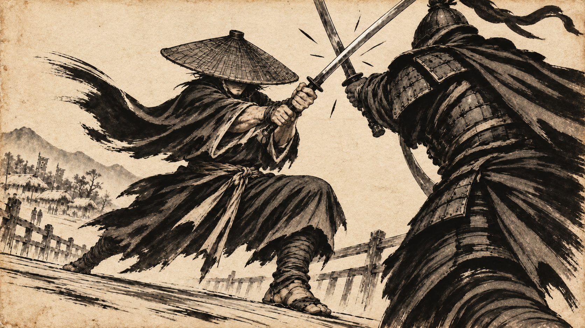

# 바꿔 수묵 검객 뮤직비디오 기획안

자신의 삶과 이상을 짓밟은 세상의 질서를 뒤집으려는 떠돌이 검객의 Google Flow 뮤직비디오다. 현재 시각 기준은 **낡은 한지 위의 명료한 먹선, 얼굴을 가린 삿갓 검객, 무게와 순간 가속이 느껴지는 전투**다.

## 제작 기준

- 곡: 글루미 써티스 Gloomy 30's의 바꿔.
- 사용자 지정 음원: https://www.youtube.com/watch?v=p4aCyJtGVm4
- 그림의 기준: 사용자가 제시한 이노우에 다케히코의 베가본드. 사실적인 인체, 힘 있는 붓선과 여백을 참고하며 이 영상의 독자적인 인물을 만든다.
- 전투 연출의 기준: [RISE Worlds 2018의 0:31~1:10](https://www.youtube.com/watch?v=fB8TyLTD7EE&t=31s). 검객의 팔과 무기 옆 시점, 전장 전체, 상대의 반응을 오가는 카메라를 사용한다.
- 화면: 가로 16:9 초안.
- 제작: Google Flow로 개별 장면을 생성하고 편집기에서 원곡과 합성한다.
- 현재 범위: 기획, 시안 이미지, Flow용 프롬프트. 실제 Flow 영상 생성은 아직 진행하지 않았다.
- 사용자 지정 구간: 2:35~2:49는 폭풍전야, 2:50~3:10은 폭발하는 전투. 2:49~2:50은 마지막 정적으로 연결한다. 실제 음원에 맞춘 프레임 단위 타격점은 후속 편집에서 확정한다.
- 최신 영상은 [20초 전투 수정본](DUEL-V2.md)이다. 상대 얼굴과 길고 가는 칼을 수정하고 원곡 2:50~3:10과 합성했다. [첫 6초 테스트](SHOT-04-TEST.md)는 비교용으로 남긴다. 전체 35초 영상은 아직 생성하지 않았다.

## 이야기

**나를 망가뜨린 세상의 질서를, 내 손으로 뒤집는다.**

검객의 출발점은 빼앗긴 삶에 대한 복수심이다. 그 분노는 사람을 짓밟고 무릎 꿇리는 권력과 질서를 향한다. 검객이 품었던 이상은 칼을 쥐지 않아도 자유롭게 걸어갈 수 있는 세상이다. 이 이상과 현실의 모순을, 내려놓은 검의 이미지에서 칼자루를 움켜쥔 손으로 이어 보여준다.

곡의 불평등에 대한 저항과 변화를 향한 의지를 이 이야기로 옮긴 창작 해석이다. 구체적으로 무엇을 빼앗겼는지는 후속 이야기 작업에서 정한다. 마을과 주민은 이 질서가 남긴 피해를 드러내는 배경이다. 마지막에는 무릎 꿇던 사람이 일어나고 막혀 있던 길이 열리는 변화로 검객의 싸움이 세상에 남긴 결과를 보여준다.

## 인물과 소품

| 요소 | 고정 설정 | 역할 |
| --- | --- | --- |
| 떠돌이 검객 | 넓은 한국식 삿갓을 깊게 쓴 성인 남성. 눈과 코는 챙 아래 짙은 그림자에 가리고 턱과 입가만 조금 보인다. 해진 먹색 도포, 천 허리띠, 소박한 외날검 한 자루. | 몸의 기울기와 손의 힘, 멈추는 발로 감정을 전달한다. 전투 중에도 삿갓은 머리에 고정한다. |
| 마을 사람들 | 평범한 옷과 생업의 흔적을 먹으로 그린다. | 부조리한 질서 아래 살아가는 사람들. 검객의 내면을 나타내는 SHOT 02에는 등장하지 않는다. |
| 징발대와 지휘관 | 창과 깃발, 무거운 갑옷, 볼가리개가 있는 투구. 지휘관의 얼굴은 보여준다. | 검객의 삶과 이상을 짓밟는 권력의 얼굴. 전투 중 흔들리는 표정과 몸의 반응을 접사로 잡는다. |
| 다리 | 마을과 외부를 잇는 좁은 나무다리. | 검객이 떠나는 길에서 마을을 지키는 경계로 바뀐다. |

## 화풍

- **바탕:** 낡은 한지의 옅게 누런 종이색. 섬유와 약한 얼룩을 남기되 인물의 윤곽과 경쟁할 만큼 거칠게 만들지 않는다. 따뜻한 색은 종이 자체의 색이다.
- **안료:** 검은 먹과 물로 희석한 회색만 쓴다. 피부색, 주홍색, 금색 등 별도 채색은 없다.
- **선:** 삿갓의 챙, 칼날, 손가락, 팔과 다리의 윤곽은 경계가 또렷한 붓끝 선으로 그린다. 칼과 손이 한 덩어리로 뭉개지지 않게 한다.
- **면:** 머리카락과 도포는 큰 먹 면과 선택한 주름선으로 정리한다. 맨 종이를 남겨 하이라이트와 여백을 만든다.
- **질감:** 갈필은 휘날리는 옷자락 끝과 동작 궤적에 제한한다. 인물 전체에 번짐이나 먹 튐을 뿌리지 않는다.
- **얼굴:** 삿갓 아래 어두운 면으로 가린다. 눈을 보여주거나 얼굴 접사를 감정 전달의 중심으로 삼지 않는다.
- **배경:** 마을과 산은 옅은 먹으로 간결하게 그린다. 중요한 인물과 무기의 선은 배경보다 선명하게 유지한다.
- **영상:** 종이의 섬유와 얼룩은 화면에서 안정적으로 유지하고 매 프레임 무작위로 깜빡이지 않게 한다.

## 현재 시안

낮은 시점에서 검객의 굽힌 무릎, 비튼 허리, 버티는 발과 교차하는 칼을 보여준다. 얼굴은 삿갓으로 가리고 손과 무기의 윤곽을 살린다. 최초 시안은 비교용으로 assets/concept-01.png에 보존한다.

## 전투 연출

전투는 **자세를 낮춰 힘을 모으기 → 짧고 빠른 진입 → 충돌 → 무게를 받는 반동**으로 구성한다. RISE를 출발점으로 삼아 이 검객의 싸움에 적용하는 연출 제안이다. 연속 슬로모션보다 정상 속도와 순간 가속의 차이로 힘을 만든다.

- 후방 발이 바닥을 밀고 골반이 먼저 이동하며 상체와 칼이 따라간다.
- 공격 전에는 상대와의 거리와 발 위치를 보여준다. 충돌 후에는 몸이 밀리거나 다리가 충격을 받는 결과를 보여준다.
- 카메라를 검객의 팔과 무기 바로 뒤, 전장에서 멀리 떨어진 위치, 상대의 얼굴 옆으로 옮긴다. 무기의 압력, 전체 위치, 타격의 결과를 번갈아 보여준다. 외부에서 주인공 전신만 바라보는 구도를 반복하지 않는다.
- 교전의 진행 방향은 왼쪽에서 오른쪽으로 유지한다. 방향을 바꾸려면 넓은 화면으로 위치를 다시 보여준다.
- 충돌 순간의 2~3프레임 정지는 편집에서 시험한다. 긴 정지나 반복 줌으로 모든 공격을 강조하지 않는다.
- 검의 궤적은 또렷하게 유지하고 주변의 짧은 갈필 몇 획만 동작을 보조한다.
- 칼과 손이 읽히도록 과한 모션 블러, 화면 전체 먹안개, 과도한 흔들림은 줄인다.
- 한 번의 교환을 준비, 진입, 충돌, 반동으로 나누어 생성한다. 한 클립에 긴 연속 합을 몰아넣지 않는다.

## 이야기의 장면 순서

| 순서 | 장면 | 사건과 시각 연출 |
| --- | --- | --- |
| 1 | 떠돌이 | 삿갓 그림자와 닳은 신발, 검집으로 세상 밖으로 밀려난 사람을 소개한다. |
| 2 | 부조리 | 강제로 무릎을 꿇린 사람과 막힌 길을 통해 권력의 질서를 보여준다. |
| 3 | 상처 | 검객에게도 그 질서가 남긴 상처가 있음을 짧은 흔적으로 제시한다. 구체적인 과거 사건은 추후 정한다. |
| 4 | 첫 저항 | 몇 차례의 교전으로 몸이 지치고 한계에 몰리는 과정을 만든다. |
| 5 | 폭풍전야 | 2:35~2:50. 대치, 빼앗긴 이상의 이미지, 칼자루를 쥔 손으로 긴장을 압축한다. |
| 6 | 폭발 | 2:50~3:10. 무기 옆 시점, 전장 전체, 상대의 반응을 오가는 전투. |
| 7 | 변화 | 3:10 이후. 무릎 꿇던 사람이 일어나고 막힌 길이 열리는 변화를 검객의 이상과 연결한다. |

## 지정 클라이맥스 시안

6장의 현재 시안과 상세 편집 계획은 [SEQUENCE.md](SEQUENCE.md)에 있다. SHOT 02는 검객 자신의 이상이며, SHOT 04~06은 카메라 수정판을 사용한다. 최신 생성 프롬프트는 [sequence-flow-prompts.txt](sequence-flow-prompts.txt)를 우선한다. 기존 flow-prompts.txt는 개별 동작 시험용이다.

## Google Flow 작업 순서

1. assets/concept-04.png를 현재 화풍과 삿갓 검객의 기준으로 사용한다. 삿갓 챙의 폭, 그림자, 도포와 검의 모양을 기준 이미지에 고정한다.
2. 첫 시험은 이 이미지를 시작 프레임으로 넣고 충돌 직후 무게를 받아 버티는 동작을 생성한다. flow-prompts.txt의 TEST 01을 사용한다. 이미 칼이 맞닿아 있는 시작 이미지이므로 돌진 이전 장면으로 억지로 되돌리지 않는다.
3. 진입 전 자세와 이동 장면은 별도의 시작 이미지를 준비한다. 4초 등 짧은 길이를 지원하는 모델에서는 짧은 클립부터 시험한다.
4. 시작 프레임이나 참조 이미지에 더해 공통 화풍과 인물 고정 문장을 각 프롬프트에 함께 넣는다. 기능 지원은 선택 모델에서 확인한다.
5. 사용자 지정 2:35~3:10의 35초를 우선 검증한다. 고요함과 폭발의 대비, 무기 옆 시점과 전장 전경 및 상대 반응 사이의 연결을 확인한다.
6. 원곡 파형과 구간을 확인해 전곡 장면표를 확정한다. 박자와 충돌의 정지는 편집 단계에서 맞춘다.

## 검수 기준

- 삿갓이 머리에 고정되고 눈과 코가 챙 아래 그림자에 가려지는가.
- 한지색 이외의 채색이 생기지 않는가.
- 손, 칼, 삿갓 챙의 윤곽이 움직임 중에도 선명한가.
- 갈필과 먹 번짐이 인물의 형태를 흐리지 않는가.
- 발이 바닥을 밀고 몸이 충격을 받는 과정이 보이는가.
- 등장인물별 칼 한 자루와 손가락, 팔다리 수가 유지되는가.
- 종이 질감이 시간에 따라 끓거나 깜빡이지 않는가.
- 빼앗긴 이상과 복수의 동기, 잘못된 질서를 바꾸려는 의지가 이어지는가.
- 카메라가 주인공을 밖에서 바라보는 구도에 치우치지 않고 상대의 반응과 공간을 전달하는가.

## 참고

- [사용자 지정 곡](https://www.youtube.com/watch?v=p4aCyJtGVm4)
- [벅스 곡 정보와 가사](https://music.bugs.co.kr/track/1897561)
- [사용자 지정 전투 영상](https://www.youtube.com/watch?v=fB8TyLTD7EE)
- [Fortiche의 RISE 제작 소개](https://forticheprod.com/portfolio/rise/)
- [Google Flow 영상 만들기](https://support.google.com/flow/answer/16353334?hl=en)
- [Google Flow 모델별 기능](https://support.google.com/flow/answer/16352836)
