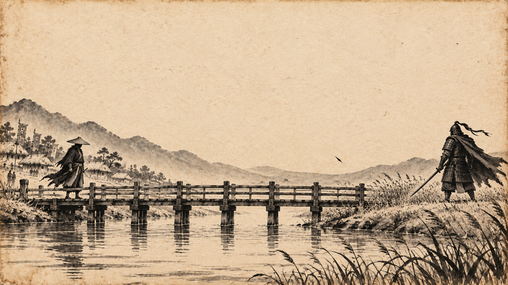
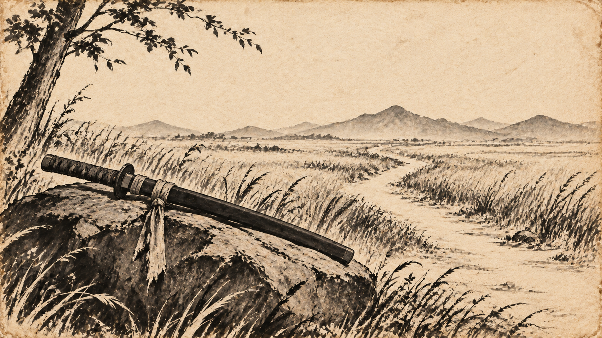
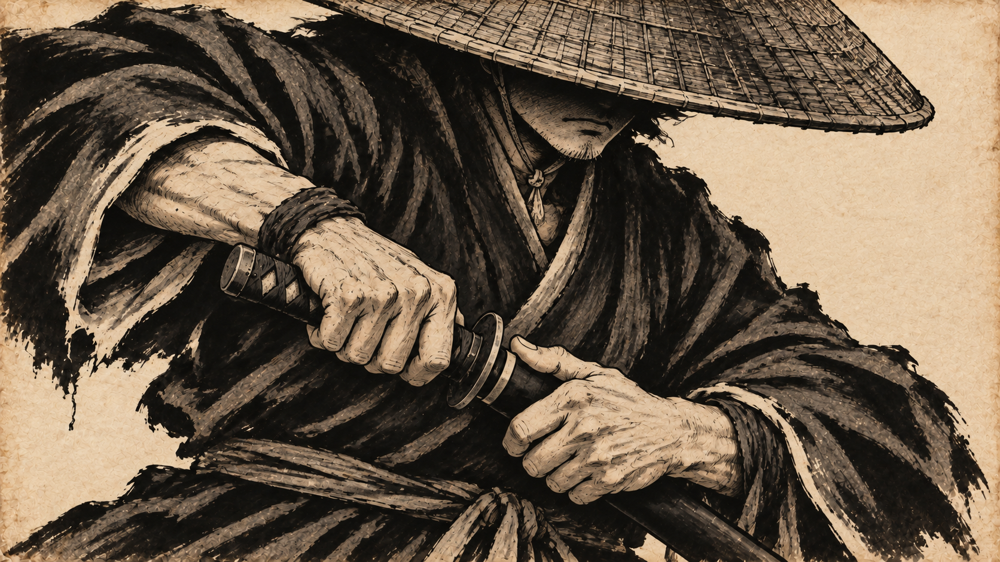
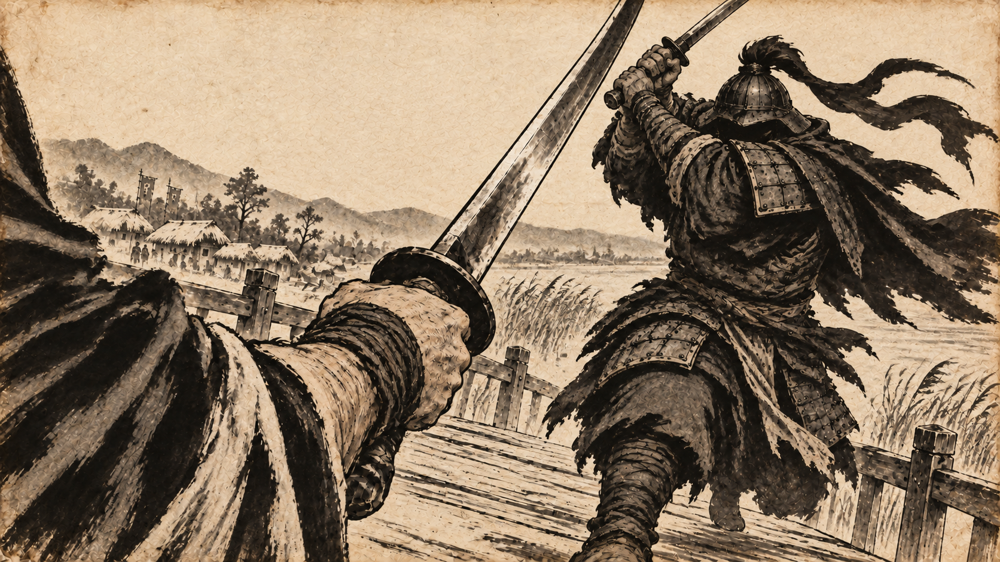
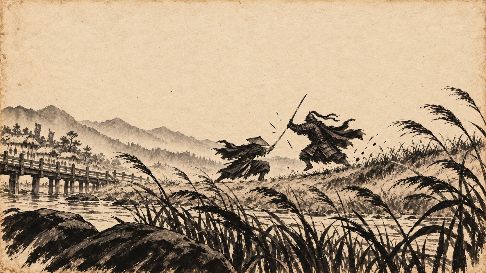
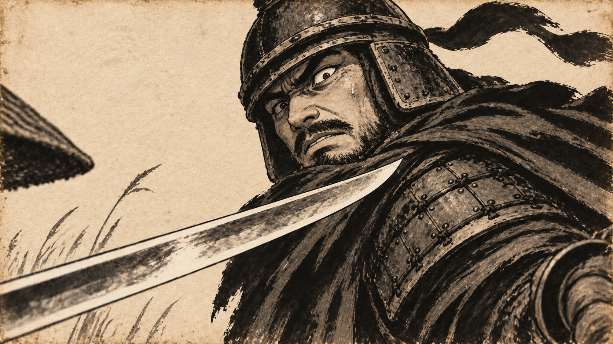

# 바꿔 폭풍전야와 전투 클라이맥스 장면 시안

최신 전투 영상은 [20초 수정본](DUEL-V2.md)이다. 아래는 고요함을 포함한 초기 35초 구성과 시안이며, 수정본에는 새 상대 얼굴과 긴 가는 칼을 적용했다.

**복수로 시작해, 자신의 삶과 이상을 짓밟은 세상의 질서를 뒤집는 싸움으로 나아간다.** 검객이 꿈꾸는 것은 칼을 쥐지 않아도 살아갈 수 있는 세상이다. 지휘관은 그 꿈을 짓밟는 권력의 얼굴이다.

곡의 2:35~2:49를 고요한 긴장으로 쌓고, 2:50부터 3:10까지 전투를 터뜨린다는 사용자 지정 구조를 6장으로 구체화했다. 2:49~2:50의 마지막 한 초는 칼을 뽑기 직전의 정적으로 묶는다. 아래 배치는 음악을 프레임별로 분석한 결과가 아닌 연출 초안이며, 정확한 타격 프레임은 실제 음원과 편집할 때 맞춘다.

## 지정 구간

- 곡: [바꿔 2분 35초부터](https://www.youtube.com/watch?v=p4aCyJtGVm4&t=155s).
- 전투 참고: [RISE 31초부터 1분 10초](https://www.youtube.com/watch?v=fB8TyLTD7EE&t=31s).
- 화풍: 낡은 한지에 검은 먹과 회색 농담, 명료한 윤곽선. 삿갓 아래 얼굴은 가린다.
- 6장은 각 구간의 대표 이미지다. 전투 구간에는 발의 접사와 무기 반동 등의 짧은 컷을 더할 수 있으며, 이미지를 그대로 6개 클립으로 길게 늘이는 편집을 전제하지 않는다.

## 장면 배치

| 장면 | 곡 구간 | 길이 | 정서와 화면 |
| --- | --- | --- | --- |
| 01 | 2:35~2:40 | 5초 | 긴 다리 양끝에서의 대치. 움직임을 거의 멈추고 넓은 여백으로 압력을 만든다. |
| 02 | 2:40~2:45 | 5초 | 주관적인 이상의 이미지. 바위에 내려놓은 검, 울타리 없이 이어지는 길. |
| 03 | 2:45~2:50 | 5초 | 현실의 칼자루를 쥔 손으로 복귀. 칼을 뽑기 직전의 숨을 마지막 한 초까지 붙잡는다. |
| 04 | 2:50~2:56 | 6초 | 검객의 팔과 무기 바로 뒤에 카메라를 둔다. 칼끝 너머로 상대가 달려든다. 첫 큰 가속을 2:50에 배치한다. |
| 05 | 2:56~3:03 | 7초 | 멀리 떨어진 낮은 카메라로 두 사람과 전장 전체를 잡는다. 근경의 갈대와 원경의 싸움으로 크기 차를 만든다. |
| 06 | 3:03~3:10 | 7초 | 상대의 반응 접사. 칼이 전경으로 파고들자 지휘관의 확신이 흔들린다. 이어 반격과 결과의 짧은 컷을 잇는다. |

구간은 시작 시각을 포함하고 다음 구간의 시작 직전까지 사용한다. 총 35초이며 고요함 15초, 전투 20초로 나뉜다.

## 장면 01 폭풍전야의 대치

**2:35~2:40.** 검객과 지휘관 사이의 거리를 크게 둔다. 검객은 칼집에 든 검과 낮은 삿갓으로 정적인 검은 실루엣을 만든다. 갈대와 천도 크게 흔들지 않는다. 음악은 원곡을 유지하며, 시각적 정적을 위해 음원을 임의로 무음 처리하지 않는다.

## 장면 02 칼을 내려놓을 수 있는 세상

**2:40~2:45.** 그가 꿈꿨지만 빼앗긴 삶을 주관적인 이미지로 보여준다. 칼집에 넣은 검을 바위에 내려놓고도 자유롭게 걸어갈 수 있는 길이다. 특정 아이나 가족에 대한 보호를 이 컷의 중심에 두지 않는다. 이 검은 현실의 검이 순간이동한 것이 아니라 검객의 내면에 떠오른 상징이다.

## 장면 03 멈춘 숨과 칼자루

**2:45~2:50.** 이상의 이미지에서 현실로 돌아온다. 같은 칼의 손잡이 형태를 연결하되, 이제 손이 그것을 놓지 못하고 움켜쥐고 있다. 챙 아래 눈은 보이지 않는다. 검은 마지막 순간까지 칼집에 두고, 긴장을 미리 풀지 않는다.

## 장면 04 검객의 무기 너머로

**2:50~2:56.** 카메라를 검객의 팔 바로 뒤, 무기를 내민 위치에 둔다. 검객의 전신을 밖에서 보여주는 대신 자신의 칼과 상대의 칼 사이에 놓인 듯한 거리감을 만든다. 검객의 얼굴은 보이지 않는다. 발 디딤과 발검의 짧은 삽입 컷으로 시작한 뒤 이 시점으로 들어간다. 게임 화면처럼 고정된 시점을 유지하지 않고 충돌에 맞춰 짧게 물러나거나 상대를 추적한다.

## 장면 05 전장을 가르는 두 실루엣

**2:56~3:03.** 극근경의 무기 컷에서 멀리 떨어진 전장 전체로 급격히 넓어진다. 큰 갈대와 바위가 카메라 앞을 잡고, 작은 두 실루엣의 높이와 공격 방향이 보인다. 다리, 강가, 갈대밭을 함께 보여 공간을 다시 이해시킨다. 넓은 화면에도 큰 내려찍기와 낮은 회피가 읽혀야 한다. 실제 전투에는 무기 충돌과 몸의 반동을 짧게 끼워 넣는다.

## 장면 06 상대가 반격을 알아차리는 순간

**3:03~3:10.** 카메라가 지휘관에게 붙는다. 검객의 반격은 전경의 칼날로만 들어오고, 적의 눈과 굳어지는 턱, 뒤로 빠지는 어깨가 결과를 전달한다. 눈을 숨기는 설정은 주인공에게 적용하며 적의 표정은 보여준다. 이 반응을 7초 내내 유지하지 않고 반격의 시작, 반응, 넓은 결과 컷을 빠르게 잇는다.

## 전투 카메라의 연결

현재 시안 3장은 아래 편집의 핵심 시점을 대표한다. 삽입 컷은 추가 제작할 대상이다. 소수점 타임코드는 연출 가안이며 원곡의 타격음을 분석해 얻은 프레임은 아니다.

| 곡 구간 | 시점과 동작 | 역할 |
| --- | --- | --- |
| 2:50.0~2:50.6 | 발이 나무바닥을 미는 극접사 | 정적을 깨는 첫 힘 |
| 2:50.6~2:51.2 | 칼집에서 빠져나오는 칼의 접사 | SHOT 03의 긴장을 행동으로 전환 |
| 2:51.2~2:53.2 | 검객의 팔과 무기 바로 뒤 | 상대의 접근을 검객 위치에서 체감 |
| 2:53.2~2:54.0 | 두 칼이 닿는 근거리 측면 | 접촉을 명확히 제시 |
| 2:54.0~2:56.0 | 무기 뒤에서 밀려나는 짧은 시점 | 충격을 받은 거리 변화 |
| 2:56.0~2:58.5 | 전장을 멀리서 보는 넓은 화면 | 두 사람의 위치와 고저차 |
| 2:58.5~2:59.3 | 상대의 어깨 너머 검객의 낮은 회피 | 이번에는 공격하는 적의 위치로 이동 |
| 2:59.3~3:01.0 | 바닥을 찍은 상대 칼의 접사 | 큰 공격의 실패 |
| 3:01.0~3:03.0 | 낮게 빠져나오는 검객의 측면 | 반격의 원인을 제시 |
| 3:03.0~3:04.2 | 상대의 반응 접사 | 반격을 인지하는 찰나 |
| 3:04.2~3:06.0 | 검객의 무기 뒤에서 반격을 따라감 | 공격에 다시 들어감 |
| 3:06.0~3:08.0 | 두 사람을 담은 먼 전경 | 반격이 전장에 남긴 변화 |
| 3:08.0~3:10.0 | 상대의 손과 흔들리는 무기, 이어 전신 | 힘과 권위가 무너지는 결과 |

카메라가 바뀌어도 검객과 적의 위치 및 시선 방향을 연결한다. 전경은 위치를 다시 세우고, 팔 옆 시점은 무기의 압력을, 적의 접사는 공격의 결과를 보여준다. 주인공 전신 구도의 반복을 피하면서도 모든 컷을 임의의 회전이나 흔들림으로 채우지 않는다.

## 주제와 결말의 연결

2:35 이전에 세상의 부조리가 검객에게 남긴 상처를 보여준다. 검객의 과거를 전부 설명하기보다 막힌 길, 강제로 무릎을 꿇린 사람, 빼앗긴 삶의 흔적을 선택해 제시한다. 구체적인 과거 사건은 후속 이야기 작업에서 정한다.

2:50의 공격에는 분노와 결단이 함께 있어야 한다. 3:10 이후에는 그 공격이 세상에 만든 변화를 보여준다. 무릎을 꿇던 사람이 일어나고 막혀 있던 길이 열리는 구도를, 장면 02의 길과 연결하는 결말을 제안한다. 작품 속 싸움의 결과를 한 사람을 이겼다는 사실보다 넓게 전달한다.

## 생성과 편집

- sequence-flow-prompts.txt에는 6개 대표 장면과 추가 발검 컷의 Flow 프롬프트가 있다.
- sequence-image-prompts.txt에는 시안 생성에 사용한 지시문을 보관한다.
- 시안은 동작의 대표 프레임이며 모두를 시작 프레임으로 사용하면 이미 충돌한 자세에서 다시 공격하려는 문제가 생길 수 있다. 장면 04~06은 준비 자세를 시작 프레임으로 별도 제작하고 시안을 구도나 도착 자세의 기준으로 사용한다.
- 고요한 장면은 미세한 움직임만 허용한다. 전투는 짧은 동작 단위로 생성한 뒤 앞뒤 여유를 잘라 붙인다.
- 충돌 순간의 짧은 정지와 가속, 최종 타격 위치는 원곡을 편집기에 넣은 뒤 정한다. 생성 영상에 긴 자동 슬로모션이나 과장된 흔들림을 요구하지 않는다.
- 이미지 시안과 편집 계획에 이어 Gemini API로 SHOT 04를 6초 시험 생성하고 원곡 2:50~2:56과 합성했다. [첫 전투 테스트 결과](SHOT-04-TEST.md)에 영상과 검수 내용을 보관한다. 전체 35초 영상은 아직 생성하지 않았다.
